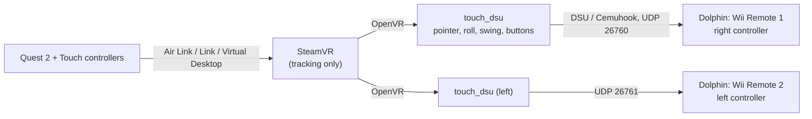

# Touch → Dolphin

Play Wii games in [Dolphin](https://dolphin-emu.org) on a normal monitor with **Meta Quest Touch controllers** as real Wii Remotes: aimed pointer, roll, swings, buttons, and a second player on the left controller. No VR display is used.



The headset only _tracks_ the controllers. SteamVR hands their poses to a small Rust bridge, which pretends to be a DualShock-style pad with motion sensors (the DSU protocol Dolphin already understands). Nothing in Dolphin is patched.

## Requirements

- Windows, Rust (stable, via rustup), Dolphin (tested on 2609b)
- A Quest (tested: Quest 2) connected to the PC through **Air Link, Link or Virtual Desktop**, with SteamVR running
- Nothing else: `openvr_api.dll` is loaded from the SteamVR install at run time, and the bridge has no third-party crates

## Quick start

1. Connect the headset to the PC and start SteamVR. Wake both controllers (press a button) and hold them in front of the headset cameras.
2. **Close Dolphin**, then copy the files in `config/` into `%APPDATA%\Dolphin Emulator\Config\` (merge `WiimoteNew.ini`; see [Dolphin setup](#dolphin-setup)).
3. Start the bridges: `scripts\start.ps1` (stop them with `scripts\stop.ps1`).
4. Open Dolphin and a Wii game. Aim at the middle of the screen and **click the right thumbstick** to recenter.

## Controls

| Touch               | Wii Remote                  |
| ------------------- | --------------------------- |
| Aim the controller  | Pointer                     |
| Roll the controller | Hand tilts                  |
| Fast swing          | Motion (tennis, bowling, …) |
| A                   | A                           |
| Right grip          | B                           |
| B                   | 1                           |
| Y                   | 2                           |
| X                   | −                           |
| Right trigger       | Home                        |
| Left menu           | +                           |
| Right thumbstick    | D-pad                       |
| Thumbstick click    | Recenter                    |

The left controller acts as a Nunchuk on Wii Remote 1: stick = stick, grip = C, trigger = Z, and its motion drives the Nunchuk's accelerometer, so Boxing punches work with both hands. **Ctrl+Alt+L** switches the left controller on and off while you play, and the game sees the Nunchuk being plugged in or pulled out (the bridge sends L3 while the left controller is on and tracked, and `config/WiimoteNew.ini` binds Wii Remote 1's `Extension` to it). For two players, use Wii Remote 2 on the left controller instead.

**Hotkeys** (global, Ctrl+Alt so they never clash with Dolphin's own F-keys; either Ctrl and either Alt work, so Right Ctrl + Right Alt does too):

| Keys           | Action                                                                         |
| -------------- | ------------------------------------------------------------------------------ |
| Ctrl+Alt+L     | Switch the left controller (Nunchuk / Wii Remote 2) on or off                  |
| Ctrl+Alt+] / [ | Cycle the pointing-axis candidate (only if aiming feels rotated for your grip) |

One beep: high = second controller connected, low = disconnected.

## Dolphin setup

Dolphin rewrites its config on exit, so **edit config files only while Dolphin is closed.**

| File (`%APPDATA%\Dolphin Emulator\Config\`) | What to do                                                                                         |
| ------------------------------------------- | -------------------------------------------------------------------------------------------------- |
| `DSUClient.ini`                             | Copy `config/DSUClient.ini` (two servers: right and left bridge)                                   |
| `WiimoteNew.ini`                            | Merge `[Wiimote1]` and `[Wiimote2]` from `config/WiimoteNew.ini`                                   |
| `Dolphin.ini`                               | Under `[Input]` set `BackgroundInput = True` so the game keeps input when another window has focus |

In Dolphin, Controllers → Wii Remote 1 and 2 must be **Emulated Wii Remote**. Leave **Extension: None** unless a game needs a Nunchuk (Wii Sports asks you to unplug it).

## Troubleshooting

| Symptom                         | Cause / fix                                                                                                                                                   |
| ------------------------------- | ------------------------------------------------------------------------------------------------------------------------------------------------------------- |
| Hand doesn't appear             | Pointer pinned off-screen. Aim at the screen and click the right thumbstick.                                                                                  |
| Controllers vanish from SteamVR | They sleep when idle and need the headset cameras. Press a button; run `tools\keep_headset_awake.ps1` so the headset itself doesn't sleep.                    |
| Pointer drifts / jitters        | The headset can't see the controller (position is frozen, only the gyro is working). Put the headset on a stand facing you, 1–2 m away, controllers in front. |
| Emulator froze after a hotkey   | F10 is Dolphin's **Pause** (F9 = screenshot). Press F10 again. The bridge hotkeys use Ctrl+Alt for this reason.                                               |
| Face buttons wrong              | Dolphin reads face buttons from the analog fields in Square, Cross, Circle, Triangle order; see `crates/dsu`.                                                 |
| Nothing at all                  | `cargo run -p tools --bin dsu_probe` shows whether the bridge produces data; `cargo run -p tools --bin list_devices` shows what SteamVR sees.                 |

## Layout

```
crates/bridge       the bridge (binary touch_dsu): poses -> pointer, roll, swings, buttons -> DSU pad
crates/dsu          the DSU (Cemuhook) server, with Dolphin's packet quirks
crates/openvr-sys   SteamVR's openvr_api.dll, loaded at run time (unsafe FFI lives only here and in win32-sys)
crates/win32-sys    key state, beep, timer resolution
crates/geometry     Vec3 / Mat3, shared by every crate
crates/numeric      the one checked float-to-integer conversion
crates/tools        diagnostics: dsu_probe, list_devices, controller_tip_pose, calibrate_pointing_axis, telemetry_tail
scripts/            start.ps1 / stop.ps1 (PID-based, never kills by name)
config/             Dolphin config for Wii Remote 1 and 2
tools/              keep_headset_awake.ps1
docs/how-it-works.md   the findings behind every design choice
```

## Limits

- Needs the headset and SteamVR; the Touch controllers cannot be paired to a PC directly (they only bond to their headset).
- Tracking quality is the headset's: out of its camera view the controller falls back to gyro-only rotation.
- MotionPlus games (e.g. Wii Sports Resort) are untested: the bridge sends roll-only gyro data.
- Tested on Quest 2, Windows 11, Dolphin 2609b, Wii Sports.

## Development

- `cargo run --release -p bridge` runs one bridge; `cargo test --workspace` runs the tests.
- `pnpm install` once, then `pnpm lint` / `pnpm lint:fix` run the avi12 lint as in pade: clippy (pedantic, no `as`, no unwrap), rustfmt, cargo-deny, cargo-machete and the ast-grep house rules. Lint levels are generated into each `Cargo.toml` by `avi12-lint rust-config`; exemptions live in `avi12-rust.local.toml`, each with a reason.
- See [CONTRIBUTING.md](CONTRIBUTING.md), [SECURITY.md](SECURITY.md) and [CODE_OF_CONDUCT.md](CODE_OF_CONDUCT.md).

## Support

[GitHub Sponsors](https://github.com/sponsors/avi12) or [PayPal](https://paypal.me/avi12).

## License

[Apache-2.0](LICENSE)
